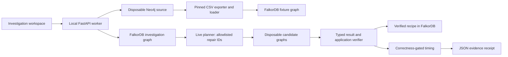

# SwitchProof architecture

The React investigation workspace talks to a localhost-only FastAPI service. One serialized worker creates the disposable Neo4j fixture, invokes the pinned exporter/loader in a temporary child-process directory, evaluates query contracts, and records evidence in FalkorDB. A process lock protects the source across CLI and API runs. HTTP accepts only allowlisted planner choices and a memory flag, never arbitrary Cypher, shell commands, or database URLs.



## Graph schema

```text
(Run)-[:HAS_QUERY]->(Query)-[:READS]->(SchemaElement)
(Query)-[:HAS_RESULT]->(Validation)
(Run)-[:TRIED]->(Candidate)-[:CHANGES]->(SchemaElement)
(Run)-[:ESTABLISHED]->(Recipe)
```

Run and Query IDs include the investigation ID. Shared SchemaElement nodes connect readers and repairs. Validation nodes contain stage, status, and serialized result evidence. Candidate nodes record accepted or rejected decisions. Recipe nodes contain an engine/schema/query key, the allowlisted repair bundle, its source preconditions, and an origin run.

The graph is operational in three places:

1. A traversal from this run's failed baseline validations through Query and SchemaElement supplies the planner's evidence.
2. A traversal through shared schema elements selects affected readers. Query-only candidates directly test their changed query; typed data candidates test all affected readers. All accepted changes then face a complete workload and app check.
3. A versioned key retrieves stored recipes. Current manifest checks and executable comparisons must pass again. Invalid or unknown recipes are rejected; a fresh live decision is requested.

Recipes are suggestions with historical evidence. They are never cached correctness verdicts. The source manifest contains fresh IDs and exact ordered role arrays. Those values are not inferred from ambiguous CSV serialization.

## Acceptance states

`queued -> running -> verified | needs_attention | abstained | error`

Verified means the declared deterministic checks passed on the recorded local fixture. The separate nondeterministic case remains inconclusive. Candidate acceptance is narrower than whole-run verification. Model errors and incomplete checks prevent a verified receipt. A lossy negative control must be rejected.

## Comparison contracts

DeepDiff runs with ordering enabled. Explicitly unordered top-level rows are sorted by canonical JSON before comparison, preserving duplicates and nested list order. Scalar types are significant. Native paths and unsupported values fail closed. HTTP graph output is normalized from positional indexes to node identities with duplicate edges retained. No universal graph-isomorphism claim is made.

## Measurement boundaries

Measurements happen after correctness, using persistent official Python clients, alternating engine order and equal resource caps. Only passing deterministic queries are timed. Source and target query text may differ, because this measures the repaired application workload. Raw samples and errors accompany summaries. Two GRAPH.COPY operations and an isolation mutation are measured separately. Copy isolation within one process is not a security boundary.

## Local execution and trust

The two pinned Docker services listen on loopback. The API binds to loopback, rejects unknown Host headers, and rejects cross-origin writes. It has no remote URL input and does not expose arbitrary query execution. The planner receives graph-selected failure evidence and preconditions, and returns only closed-schema repair IDs. Deterministic code owns all queries and mutations. Model prose cannot authorize a new operation.

Receipts and run state remain outside the code tree. `.env` is ignored. The application reads credentials from its local environment and does not serialize them. The Zero adapter discovers its endpoint and reads its request schema before bounded calls; Anthropic is the default provider.

## Demo sequence

Start with a fresh planner run. Show four observed differences and the inconclusive limit case. Open the graph view and trace source ID and role-array dependencies. Show that removing the unsupported ID field is rejected despite being executable. Inspect accepted repairs and the full final comparisons. Open application checks, then timing results with local scope visible. Export the receipt.

Restart the service or use a new CLI process. Run with memory enabled. Show the origin run, fresh precondition checks, fresh comparisons, and `revalidated: true`. This is the Track 2 evidence. An invalid stored repair or changed source precondition must not be treated as a successful remembered action.
