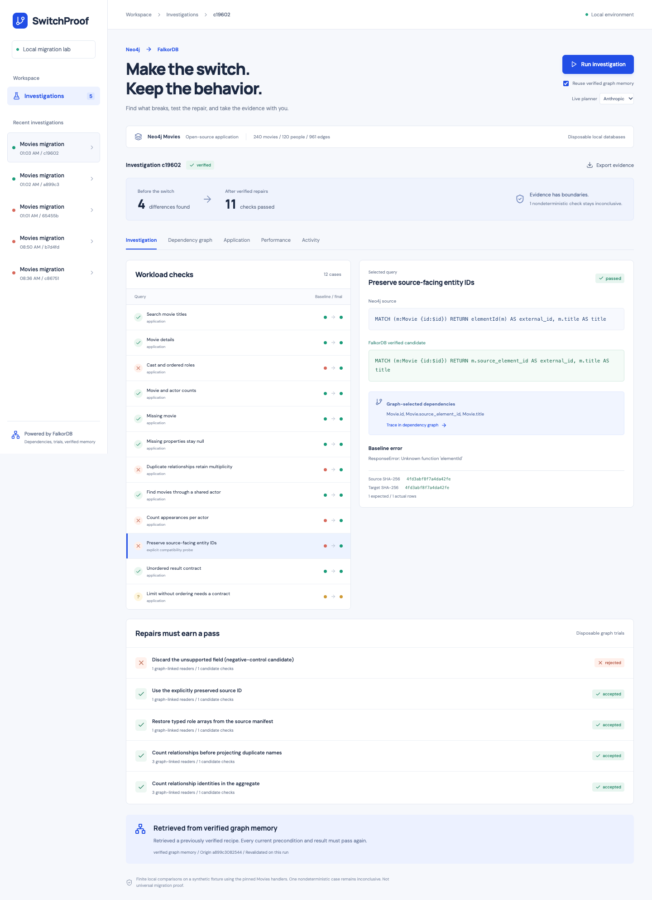

# SwitchProof

Test a Neo4j-to-FalkorDB switch before trusting it. SwitchProof migrates a reproducible Movies fixture, finds behavioral differences, asks a live model to choose from a small repair catalog, and tests the candidates in disposable FalkorDB graph copies. A successful receipt contains the actual comparisons and measured client latencies.



A live Claude Sonnet 4.6 run selected four repairs and passed all 11 deterministic query checks, seven Movies application checks, and the correctness-gated local benchmark. The lossy negative control was rejected. A second process retrieved that recipe from FalkorDB and passed fresh validation. The remaining nondeterministic query stays inconclusive. These results cover the frozen local synthetic fixture, not arbitrary applications.

The dependency graph does work: FalkorDB traversals select the failures and schema dependencies sent to the planner, find affected readers, and retrieve previously verified repair recipes. A remembered repair must pass current source preconditions and fresh comparisons again.

## Run locally

Requires Docker Compose, Python 3.12, `uv`, Node 22 or newer, and npm. This is a local lab with a fixed workload, not an arbitrary repository importer. The source database is disposable and recreated on each investigation.

```sh
./scripts/setup.sh
```

Create `.env` in this folder with a working `ANTHROPIC_API_KEY`. An optional `SWITCHPROOF_ANTHROPIC_MODEL` selects the Anthropic model; the default is `claude-sonnet-4-6`. The ignored `.env` takes precedence over inherited environment variables. Keys are never put in the evidence receipt.

```sh
./scripts/dev.sh
```

Open [localhost:18765](http://127.0.0.1:18765). Select **Run investigation**. The dashboard provides baseline and final results, query changes, graph evidence, application checks, candidate rejections, benchmarks, and a downloadable JSON receipt.

The optional Zero provider uses an existing authenticated, funded `zero` installation. It discovers and inspects its configured capability before each call, caps each call at $0.01, and reviews recorded calls. It does not create accounts or wallets. Provider failures stop the run and retain its partial evidence; no simulated model response is substituted.

CLI equivalents:

```sh
uv run python -m switchproof.engine --provider anthropic --fresh-planner
uv run python -m switchproof.engine --provider anthropic
```

The second command can reuse graph memory. It still rechecks the current source manifest, candidate results, full workload, and application behavior.

## What the demo exercises

The fixture contains 240 Movies, 120 Persons, and 961 ACTED_IN relationships, including a parallel edge. Role arrays contain a semicolon inside an element so splitting serialized strings is not a valid reconstruction strategy. A typed source manifest is captured before export.

Twelve query contracts cover search, details, ordered role arrays, counts, missing data, nulls, duplicate multiplicity, two-hop traversal, aggregation, source-facing IDs, unordered rows, and nondeterministic limits. Eleven are deterministic; `LIMIT` without ordering stays inconclusive.

The pinned pipeline on the tested engine versions exposes four differences:

- The upstream CSV path converts role arrays into strings. A repair restores exact arrays using unique source edge IDs and the authoritative manifest.
- A relationship-free projection loses parallel-edge multiplicity. The repair counts bound relationships before projecting repeated names.
- Counting neighboring movies undercounts appearance edges. The repair explicitly counts relationship identities.
- `elementId()` is unsupported on the target. The explicit compatibility probe uses the source-facing ID captured before migration.

These are observations about the pinned workload and versions, not claims about every query or current upstream release. The original Movies app does not use `elementId`; that case is labeled as an added compatibility probe.

A deliberately lossy candidate drops the external ID field. It runs successfully but must fail the result verifier. The four valid repairs are tested in copies, then the full workload is checked again before timing begins.

## Real application coverage

SwitchProof executes the pinned `neo4j-examples/movies-python-bolt` Flask handlers through their test clients. It compares search, missing input, cast, missing movie, the complete graph, vote response, and persisted vote state.

The integration uses explicit driver shims: both drivers convert the Flask `limit` argument to an integer; the Falkor driver preserves parallel-edge multiplicity for the graph projection, returns node properties to the existing serializers, and converts the client's floating query-statistics counter to an integer API counter. These shims are disclosed, and the vendored handler source remains unchanged.

Unordered collections are compared as multisets. Graph node positions are normalized to semantic identities. Nested role order, duplicate links, scalar types, missing fields, and HTTP status codes remain significant. The graph endpoint limit covers the whole fixture; arbitrary limited subsets are unverified. Votes run against a target copy, and the source vote is restored before benchmarking.

## Evidence and measurement

Receipts live in `~/.local/state/switchproof/runs/` by default, outside the repository. `SWITCHPROOF_STATE_DIR` changes this location. Receipts bind the source manifest, upstream revision, engine versions, queries and parameters, result hashes, typed differences, graph-selected planner input, model provenance, trials, raw timing samples, and a final SHA-256 digest. Hash the JSON excluding its `receipt_hash` field to verify it using the canonical serializer in `switchproof.compare`.

The benchmark uses persistent official-client connections, 3 warmups and 20 samples per engine per deterministic query. It alternates engine order, consumes results, records errors, and reports median and p95 client latency. Both Docker services have 2-CPU and 1-GiB caps. A Docker memory snapshot is retained, not presented as peak memory or JVM-equivalent usage. The full workload runs again after measurement.

The pinned upstream Rust benchmark was investigated but could not build without `protoc`. This implementation uses the planned small Python fallback; it does not claim upstream-runner results. Small local synthetic timings do not establish a production speedup.

## Verify

```sh
uv run python -m pytest -q -m 'not integration'
docker compose up -d --wait
uv run python -m pytest -q -m integration
uv run ruff check switchproof tests
npm --prefix web run build
uv run python tests/ui_smoke.py --screenshots ~/.local/state/switchproof/qa
```

The browser smoke check requires installed Google Chrome and a completed investigation in the running app. It does not start a paid planner call.

Integration tests use real local databases and an explicitly labeled test planner decision. They verify the deterministic repair pipeline, the negative control, all application comparisons, timing collection, persistent recipe reuse, invalid source preconditions, and rejection of an unallowlisted recipe. They are not evidence of a live model call.

## Graph model and tracks

[DESIGN.md](DESIGN.md) documents the model, traversals, trust boundaries, and demo sequence. Executable evidence traversals are in `queries/investigation.cypher`.

- **Track 1, Agents That Act on Connected Data:** the graph supplies investigation evidence and affected queries; the agent chooses a bounded action; disposable trials and executable checks control acceptance.
- **Track 2, Agent Memory and Coordination:** persisted verified recipes are retrieved from FalkorDB and revalidated on a later run. Only claim this demo when a receipt from a separate process shows successful reuse. No multi-agent coordination claim is made.

This repository provides the full local setup. A demo video and event submission are separate release steps.

## Open source and scope

See [THIRD_PARTY_NOTICES.md](THIRD_PARTY_NOTICES.md) and `upstream.lock.json` for pinned components and licenses. The original contribution is the graph-guided investigation, bounded repair and validation loop, persisted revalidation, evidence receipt, and dashboard. The migration loader, graph-copy operation, benchmark concept, Movies handlers, and diff library are existing work.

This version supports the frozen Movies schema and the four explicit repair recipes. It does not infer arbitrary schemas, import arbitrary repositories, execute model-generated Cypher, prove universal equivalence, or provide production/security tenant isolation.

Stop the local services with `docker compose stop`. `docker compose down` removes these disposable containers and their database state; external JSON receipts remain. No source code is committed or published by these commands.
